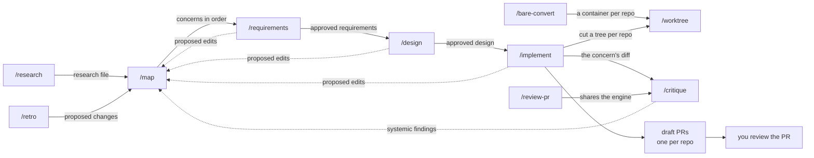

# agents

Claude Code and Codex configuration: always-on rules, plus a workflow. The workflow charts a map of
concerns and builds each concern through its own stages. It runs on the
[Solo](https://soloterm.dev) MCP server. It writes every document you read as a markdown file.

## Install

```bash
./scripts/install.sh
```

One run installs both runtimes.

| Destination | Contents | Runtime |
|---|---|---|
| `~/.claude/rules/<name>.md` | always-on working agreements — **linked per file** | Claude |
| `~/.claude/output-styles/<name>.md` | the output style — **linked per file** | Claude |
| `~/.claude/settings.json` | the `outputStyle` key only — **merged** | Claude |
| `~/.claude/skills/<name>/` | slash commands — **linked per skill** | Claude |
| `~/.claude/references` | adapters — whole directory, **never pruned** | Claude |
| `~/.claude/bin/wt-clone.sh` | the `/worktree` clone helper — **linked directly, never pruned** | both |
| `~/.agents/skills/<name>/` | the same skills — **linked per skill** | Codex |
| `~/.agents/references` | the same adapters — whole directory, **never pruned** | Codex |
| `~/.codex/AGENTS.md` | every rule and the output style concatenated — **generated** | Codex |

The script links one entry at a time, so each destination directory stays a real one you own.
It leaves anything else you keep there alone. Nothing you create locally reaches this
repository, which matters because the repository is public.

**`~/.codex/AGENTS.md` is the one file this repository generates whole rather than links.** Codex reads
its instructions from a single file and resolves no includes, so a directory of rules cannot
reach it any other way. A file you wrote yourself is backed up before the first generation. Git
hooks regenerate it after a commit, a checkout, and a merge, so a rule edit you commit reaches
Codex without a re-run. `./scripts/install.sh --rules-only` does that regeneration alone.

**Codex has no `disable-model-invocation`.** On Claude, the model cannot invoke `/bare-convert` or
`/review-pr`. On Codex it can invoke either skill itself. Each still gates on your approval before
anything lands or posts, so the guarantee weakens from "you start it" to "you approve it".

`references/` is a whole-directory link because it is not a Claude Code directory. It exists so
a skill or a rule can read a file from a stable path. Nothing else writes there. It holds two
kinds. A runtime adapter serves `solo-agent-orchestration`, which points at it before you spawn
that runtime. A skill's own overflow holds what one skill cannot fit under its size cap, and
`implement-waves.md` is the one today. `runtime-claude.md` and `runtime-codex.md` are the runtime
adapters. Each maps every policy in that rule to the flag that implements it. Each also records
the policies its runtime cannot implement at all.

The `runtime-` prefix is load-bearing. A file named `claude.md` collides with `CLAUDE.md` on a
case-insensitive filesystem. Claude Code then loads the adapter as project instructions in every
session that opens this repository.

An adapter is content you need at one moment rather than in every session. Runtime launch flags
belong here because a wrong flag fails the launch with a visible error. A rule keeps anything
whose absence fails silently.

Re-run the script after you **add or rename** a file. An edit to an existing rule or skill takes
effect immediately. An edit to the output style does not. Claude Code reads a style once per
session, so see `## Output style`. The script prunes a per-entry link — a rule, an output style,
or a skill — whose source is gone. It never prunes the two direct links, `references/` and
`bin/wt-clone.sh`. A renamed source there leaves a dangling link. It moves anything real in the
way to `~/.claude/backups/` first. Override the repository root with
`AGENTS_REPO=/path/to/agents`.

**This repository manages one key in `~/.claude/settings.json`: `outputStyle`.** It never
overwrites a value you set, and it touches nothing else in that file. It does not manage
`~/.claude/CLAUDE.md` at all. Both files are machine-local and yours.

### Requirements

| | |
|---|---|
| Solo MCP | `/research`, `/map`, `/requirements`, `/design`, `/implement`, `/critique`, `/review-pr`, `/retro`, `/worktree` |
| A docs directory | `/map`, `/requirements`, `/design`, `/implement`, `/research`, `/retro` — `~/Code/agent-docs` unless the plugin's `docs_dir` setting names another |
| `gh` CLI, signed in | `/implement`, `/review-pr` |
| Obsidian | reading maps and their progress through Bases — optional |
| Vale 3.0 or later | checking the sentence-level half of `prose-discipline` — `brew install vale`. CI pins 3.17.1 |
| jq | selecting the output style at install time — without it the install prints the instruction instead |
| `gws` CLI, signed in | `/gws` |
| Nothing | `/grill`, `/bare-convert`, and the rules |

## Rules

All six rules load into every session.

| Rule | Description |
|---|---|
| [chat-vocabulary](rules/chat-vocabulary.md) | Six reserved headings and one footer mark every message the user must act on; nothing else gets a heading |
| [comment-discipline](rules/comment-discipline.md) | Comments are disallowed by default; after the implementation, propose only the few that pass the admission test |
| [pr-first-contributions](rules/pr-first-contributions.md) | PR-first git workflow with conventional titles, draft PRs, stacked bases, and squash-merge descriptions |
| [solo-agent-orchestration](rules/solo-agent-orchestration.md) | Fan out with Solo agents, never a vendor's native sub-agent mechanism. Workers signal their own completion and report to a durable surface |
| [testing-philosophy](rules/testing-philosophy.md) | Contract-first tests through production entry points; refactor-resistant |
| [yagni](rules/yagni.md) | Build for the present need; defer what is cheap to add later |

Each description above copies that rule's `description:` frontmatter. Copy it rather than
paraphrase it, because a paraphrase drifts from the rule it describes.

## Output style

[prose-discipline](output-styles/prose-discipline.md) is a Claude Code output style, not a rule. It
combines the two standards that used to live in `rules/`: how much you say, and how you say it. The
first led with the answer and stopped when done. The second applied ASD-STE100 to every sentence.
They left `rules/` because a style gets something a rule cannot: a per-turn reminder. Release
2.1.238 exists to stop a custom style drifting back to the default voice mid-session. Both
standards fail by gradual drift. Shipping them as one style also states them once per session
rather than twice.

Three mechanisms come with a style:

- **A style takes effect at session start only.** An edit to the file needs `/clear` or a new
  session. A newly linked style file needs a new session. Claude Code caches the set of available
  styles for the life of the process.
- **Only one style is active at a time.** Another style therefore drops both standards at once.
- **It applies to all prose.** An artifact runs to whatever length its purpose requires.
- **It drops Claude Code's `# Doing tasks` section.** The style omits
  `keep-coding-instructions`, so the built-in scoping, comment, and verification guidance leaves
  the system prompt. `yagni` and `comment-discipline` cover scope and comments more strictly. The
  security guidance and the verification instruction go, and no file here replaces them.

The installer links the style and sets `"outputStyle": "prose-discipline"` in
`~/.claude/settings.json`. It leaves an `outputStyle` you set yourself alone, and it skips that step
when `jq` is absent. Codex has no output style, so `~/.codex/AGENTS.md` concatenates the style
alongside the rules.

### Checking prose

Vale checks the sentence-level half of `prose-discipline` mechanically: sentence length, voice,
verb form, and contractions. It checks none of the imperatives. "Lead with the answer", "one shape
per fact", and "stop when done" pass Vale whatever you write. Both mechanisms exist because
Vale covers committed markdown, and the per-turn style reminder covers chat, which Vale never
reads.

The two directories are one word apart. `styles/` holds the Vale rules that check the prose, and
`output-styles/` holds the Claude output style itself. `.vale.ini` and the hand-authored
`styles/STE/` Vale style live in this repository. Run Vale over the markdown you changed:

```bash
vale --minAlertLevel=warning <file>.md
```

The 25-word sentence cap and the contraction check are errors. The 20-word cap, the
passive-voice check, and the gerund check are warnings, because each one needs your judgment.

The passive-voice and gerund checks use Vale's `sequence` extension, which reads part-of-speech
tags. They match a `be` form followed by a past participle or a present participle. Vale 3.17.0
or later is required, because earlier versions read sentences from paragraphs only.

A tagger reads word forms, not meaning, so both checks report some sentences that are correct.
`The waves are done` tags `done` as a past participle even though it acts as an adjective here.
Both checks are warnings for that reason: read each one and decide.

## The workflow

**A map charts a body of work as concerns in order.** The map states the destination and the
principles every concern holds to. It also states what is still unclear, and what stays out. A
**concern** is one outcome, written as one sentence with no `and`. It lands as one branch and one
draft PR per repository it touches.

**You start each stage.** Each stage writes one document and then waits for your approval. The
next stage starts only when you start it.

```
/map                       map.md: destination, principles, concerns in order, fog, out of scope
/requirements <concern>    requirements.md: outcome, acceptance criteria, proof commands
/design <concern>          design.md: the parts that apply, each with its declined alternative
/implement <concern>       slices, waves, worktree, build, critique, draft PR, CI
review                     you review the PR
```

`/research` and `/retro` feed the map. `/research` also answers a fact that `/map`,
`/requirements`, or `/design` cannot look up. `/retro` hands its proposed changes to `/map`.

**Human documents are files, and Solo is agent-to-agent only.** Everything you read is a markdown
file under the docs directory. Solo holds briefs, guards, worker reports, todos, KV, and locks. No
document you read lives in a scratchpad. The skills commit nothing under the docs directory,
because it may be a local repository with no remote.

**A concern's stage lives only in its `concern.md`.** Its values are `open`, `requirements`,
`design`, `implementing`, `in-review`, and `done`. Each stage skill sets the stage when it starts,
and `/implement` sets `in-review` at the landing. An approval changes a document's `status`, never
the concern's `stage`. No other file repeats the stage, so no two copies can disagree.

**Obsidian shows the progress through Bases.** Every file carries `type` in its frontmatter, so a
Base can filter on it. `map.md` embeds a Base of its concerns, filtered by `type` and by map. The
Base shows each concern's `order`, `outcome`, `after`, and `stage`. The map holds no table by hand.

**Findings flow back to the map.** A stage that finds work the map missed appends a numbered item
under `map.md`'s `## Proposed edits`. When `/implement` calls `/critique`, it appends each systemic
finding there too. `/map` applies or rejects each edit, one `Approve` at a time.



## Skills

| Skill | Purpose | Invocation |
|---|---|---|
| [`/research`](skills/research/SKILL.md) | Investigate a codebase with parallel Solo agents and write the findings to a file in the docs directory | you or the agent |
| [`/map`](skills/map/SKILL.md) | Chart a body of work as a map of concerns in markdown files, or apply the edits its concerns propose | you or the agent |
| [`/requirements`](skills/requirements/SKILL.md) | Grill you on one concern, and write its outcome and acceptance criteria, each with a proof command that can fail | you or the agent |
| [`/design`](skills/design/SKILL.md) | Design one concern from its approved requirements, and put each design decision to you with real code and diagrams | you or the agent |
| [`/implement`](skills/implement/SKILL.md) | Implement one approved concern, from its requirements and design to a draft PR with CI green | you or the agent |
| [`/critique`](skills/critique/SKILL.md) | Adversarial review of a diff, a concern's documents, or files, with one critic agent per lens | you or the agent |
| [`/review-pr`](skills/review-pr/SKILL.md) | Adversarial review of someone else's pull request, with a drafted review you approve before it posts | **you only** |
| [`/grill`](skills/grill/SKILL.md) | Interrogate a decision one question at a time | you or the agent |
| [`/retro`](skills/retro/SKILL.md) | Analyse past sessions for recurring failures and hand the findings to `/map` | you or the agent |
| [`/worktree`](skills/worktree/SKILL.md) | Cut, provision, and tear down one concern worktree | you or the agent |
| [`/gws`](skills/gws/SKILL.md) | Read and change Google Drive, Docs, Sheets, and Slides files through the `gws` CLI | you or the agent |
| [`/bare-convert`](skills/bare-convert/SKILL.md) | Set up or convert a repository into the bare-plus-worktrees layout | **you only** |

Two skills keep `disable-model-invocation: true`, so the agent cannot decide to run them.
`/bare-convert` moves your working tree, and `/review-pr` posts to GitHub. Neither appears in the
agent's skill listing, so neither costs context until you invoke it.

The other ten stay model-invocable. Seven of them carry `when_to_use` trigger phrases. Say
"map this out", "grill me on this", or "find the bugs", and the skill runs without a command name.
`/requirements`, `/design`, and `/implement` carry none, so a command name starts each one. A
disabled skill cannot call another disabled skill.

`/map`, `/worktree`, and `/gws` are trigger-phrase skills that also write. `/map` writes markdown
under the docs directory and nothing else. `/implement` calls `/worktree` per concern, so it must
be callable. Its destructive half lives in `/bare-convert`, which keeps the gate. `/gws` confirms
every write with you before it sends one.

**No skill overrides the model.** Every skill respects your session's choice, including a `[1m]`
variant. A skill sets `effort` only where the shape of the work justifies it:

| Skill | `effort` | Why |
|---|---|---|
| `grill` | `xhigh` | pure judgment, no fan-out to multiply the cost |
| the rest | inherits | a raise multiplies across their parallel agents |

An effort override applies for the rest of the turn, and it resets on your next prompt. For
one-off depth, put `ultrathink` in the prompt instead.

## How the system holds state

**Files are the record, and Solo is the working set.** Every document you read is a markdown file
under `<docs_dir>`. Solo holds agent-to-agent content only, and each item there is short-lived.
Nothing in this repository stores your work.

A slug is lowercase, and it joins `date +%Y-%m-%dt%H%M` to a short topic. A concern is named
`c<n>-<short-topic>`, and it keeps that name for life. Its position lives in `order`, which may
change.

| File | Path under `<docs_dir>` | `type` |
|---|---|---|
| Map | `maps/<map-slug>/map.md` | `map` |
| Concern | `maps/<map-slug>/<concern>/concern.md` | `concern` |
| Requirements | `maps/<map-slug>/<concern>/requirements.md` | `requirements` |
| Design | `maps/<map-slug>/<concern>/design.md` | `design` |
| Implementation record | `maps/<map-slug>/<concern>/implementation.md` | `implementation` |
| Research for a map | `maps/<map-slug>/research/<topic>.md` | `research` |
| Inbox item | `maps/<map-slug>/inbox/<id>.md` | `inbox` |
| Standalone research | `research/<slug>.md` | `research` |
| Retro | `retro/<slug>.md` | `retro` |

`src/schema.ts` in `jahnkelabs/agents-obsidian` defines the inbox item format.

Each document carries only its own review state. `status` is `draft`, `awaiting-you`, or
`approved`. `awaiting` names the one thing you owe, or it is `null`. `implementation.md` adds `pr`.
`concern.md` adds `order`, `outcome`, `after`, and `stage`.

| Agent-to-agent name | Form | Tags |
|---|---|---|
| Task todo | — | `map:<map-slug>`, `concern:<concern>`, `project:<repo>`, `task:<letter>` |
| Worker report pad | `<map-slug>/<concern>/<task>` | `transient`, `map:<map-slug>`, `concern:<concern>` |
| Brief and guard pad | — | `transient`, `map:<map-slug>`, `concern:<concern>` |
| Critique pad | `critique/<slug>/<pass>/<lens>-<n>` | `transient`, plus the map and concern tags when a concern resolved |
| Research and retro worker pad | `research/<slug>/<area-slug>`, `retro/<slug>/<area-slug>` | `transient` |
| KV | `map:<map-slug>:concern:<concern>:branch:<repo>` | — |
| KV | `map:<map-slug>:concern:<concern>:worktree:<repo>` | — |
| Branch | `<type>/<map-slug>-<concern>` | — |
| Worktree | `<container>/<map-slug>-<concern>` | — |
| Compose project | `<repo>-<map-slug>-<concern>` | — |

`/implement` deletes the concern's todos and KV keys when it closes. `/research`, `/retro`, and
`/critique` archive their worker pads after they synthesize.

Skills use whichever Solo project is currently selected, and say which one in their first
confirmation.

## How the workflow behaves

**Every worker is a Solo agent.** `/research`, `/implement`, `/critique`, `/review-pr`, and
`/retro` fan out with `spawn_agent`, never with the host runtime's own sub-agent mechanism.
`/map`, `/requirements`, and `/design` reach the same workers through `/research`.
[solo-agent-orchestration](rules/solo-agent-orchestration.md) carries the policy and the
reasoning, so the policy also holds for a fan-out that no skill started. Each skill carries only
its own worker brief and constraints.

**Every worker launches in auto-approval mode.** A read-only assignment is no exception, and no
worker uses a bypass mode. Each runtime names its own flags, and it renames them between releases.
Read `references/runtime-<tool_type>.md` for the arguments rather than a list here.

**Workers signal their own completion.** Each worker wakes the orchestrator through a
one-millisecond timer as its last act, because only the worker knows that it finished. Solo
rejects a zero delay, so that is the smallest legal value. An idle timer stays as
the fallback that catches a worker which died or hung. An idle timer has no debounce, and a
worker that reasons at length emits no output and looks finished.

**Gates carry evidence for what they inferred.** A confirmation justifies the judgments it could
get wrong: why these repos, why these investigation areas, why this is out of scope. A bad guess
is then visible rather than buried. A gate prints a looked-up fact without argument. The
selected Solo project needs no justification; a repo list inferred from file references needs
one. A gate's opening message carries a reserved heading, and the decision format when it offers
options, per [chat-vocabulary](rules/chat-vocabulary.md). `Approve` marks a proposal, and
`Deciding` marks a question you cannot answer yourself.

**Each stage ends in one approval of its document.** The stage sets the document to `awaiting-you`
and names what you owe. Where md-redline is present, the stage asks for a review of the file
there. Otherwise it sends an `Approve` in chat that names the file's absolute path. Your approval
sets `status: approved`, and the stage stops.

**`/map`, `/requirements`, and `/design` grill you.** One question per message, never two. Each
question that offers options carries the decision format from
[chat-vocabulary](rules/chat-vocabulary.md). That format states what was found, how critical the
choice is, and whether it is reversible. Each option shows its pros, cons, risks, constraints, and
an example where it has one. A mandatory recommendation names its ground. A question with nothing
to rank carries only its heading, the question, and the footer. A prose question ends with the `⏸`
footer, and the question tool needs none. Only the first question carries the `Deciding` heading,
so a long grilling does not become a column of headings. The question whose answer changes the
most other answers comes first. Each stage looks up anything the filesystem or a tool can tell it,
rather than asking you. The `/map` scope gate names the decisions it expects to put to you. That
gate also reports how far each tree sits behind its default branch. A stage stops grilling when the
questions left are details you would rather see than specify.

**Every acceptance criterion carries a proof command that can fail.** `/requirements` runs each
command against the current tree, where it can run. A command that already passes proves nothing,
so the stage tightens it. Each criterion also names an invariant, which is what must not change
while the concern reaches it. Workers and the critique run the commands again.

**`/design` shows each decision as code.** It walks six parts: structure, data model, interfaces,
call patterns, failure handling, and decisions. It writes only the parts that apply. Each part
names its declined alternative, and each acceptance criterion needs a part that makes it hold. A
criterion the design cannot meet is a change to the requirements, so `/design` stops with a
`Blocked`.

**`/implement` censuses the inbound references before it creates the todos.** It searches for
three kinds of reference to every file a slice changes. Those kinds are the caller, the test, and
the standard whose text the change makes false. The third kind is the one that gets missed,
because no import points to it. Nineteen of thirty sessions shipped an incomplete file list before
this step existed.

**Three words carry the delivery model, and each means one thing.** A **concern** is one outcome
of a map, and the unit of delivery. A **slice** is one worker's unit of work: narrow, vertical,
one repository. A **wave** is the concurrency schedule inside a concern, taken from file overlap.

**`/implement` derives the slices from the approved documents.** The design's `## Structure`
supplies the files, and the requirements supply the criteria. A slice may also carry one
constraint: `same-worker as` another slice, or `after` another slice. `/implement` orders the
waves from file overlap. It chooses a model and effort for each task against facts that are
current at execution time. It writes each task's summary so the tier follows from it. A task
described as "three localized edits against precise line references" argues for its own tier.

**A concern lands one PR per repository it touches.** Its outcome is one sentence with no `and`,
and each PR title states that outcome scoped to its repository. Two concerns that change one file
need an `after` between them. The census proposes the map edit when it finds the `after` missing.
A concern that comes `after` an unmerged one opens its PR on the predecessor's branch. A concern
gets its own worktree per repository through `/worktree`, so no worker ever shares your tree.

**Your approval of the documents authorizes the build.** `/implement` starts only on approved
requirements and an approved design. Starting it authorizes the concern's branch pushes and its
draft PR. No gate stands between the documents and the PR. It stops on these conditions and no
others:

- a stage document that is missing or not approved;
- a `/worktree` refusal;
- a census hit that needs a behavior the design does not describe;
- a worker deviation;
- a critique escalation;
- a check that still fails after two CI fixes.

**Both runtimes bound an immutable-target worker's writes by directory.** That worker reads the
target and writes only scratch, and the operating system enforces the bound. On Claude the
sandbox covers Bash alone. `Read`, `Edit` and `Write` use the permission system, so the brief
also needs a tool deny list. Codex keeps `/tmp` and `$TMPDIR` writable, so it does not isolate
one worker's scratch directory from another's. Each runtime adapter carries the arguments and
the date of its last measurement.

An editing worker is the harder case. No directory-scoped posture denies git in the worktree the
worker edits. Claude denies `git add` per command, and Codex has no per-worker equivalent. The
rule requires that gap disclosed rather than restated as a promise. `/worktree` cuts one tree per
concern and per repository, so several workers share one. Two Codex workers that stage in that
tree cross-commit silently. Where the runtime cannot deny the writes, the first `Running` block
carries a `Sandbox:` line that discloses the exposure. `/implement` does not close it. A
worker takes a lock only where a second run or a person may edit the same tree. The orchestrator
commits each task's declared paths at the wave join, so history stays granular.

**Workers escalate on deviation, not on failure.** A worker that cannot self-resolve records
what it found and stops. So does a worker that would have to depart meaningfully from the
approved requirements or design. Neither one improvises. The record is the worker's report
scratchpad, and its completion signal says that it escalated, so you have one place to look. Other
workers in the wave finish, and everything appears together at the join. A settled deviation
updates `design.md` or `requirements.md`, and `implementation.md` records it.

**Critique is adversarial, with one agent per lens.** A lens is one question about the target,
such as requirements fidelity, correctness, or security. `references/critique/lenses/` holds one
file per lens. Each file states when the lens applies, its model and effort, and what it never
reports. Each agent tries to break the target on its own question rather than survey it. A lens
whose question needs an intent runs only when the caller supplies one. `/implement` supplies the
concern's requirements and design.

**The lenses run in two batches.** Batch 1 holds requirements fidelity, design conformance, and
root cause. Batch 2 holds the rest. Batch 2 waits for batch 1 because a rework changes the code
batch 2 reads. In `apply` mode, an in-design batch 1 failure goes back for rework, and batch 1 then
runs again with fresh agents. Two rework rounds are the limit. In `apply` mode, a finding that
departs from the approved design stops the critique and waits for you. In `report` mode, the
ledger marks it `deviation:`, and batch 2 starts once batch 1 finishes.

**A refutation pass checks every finding.** One refuter per finding argues that the failure cannot
occur. It defaults to `refuted` when it is uncertain, and the critique drops what it refutes. This
pass replaces cross-model agreement, which is no evidence when every critic runs one model. Every
surviving finding reaches the filter, whichever lens raised it.

**Every finding carries a scope.** `scope: local` means the cause sits in code the work owns.
`scope: systemic` means other code shares the cause. Only the root-cause lens raises a systemic
finding. It gets no local patch. It becomes a proposed map edit on a `proposed edit:` line.

**Two front ends share one engine.** `/critique` reviews your own work, standalone or inside
`/implement`. `/review-pr` reviews someone else's pull request, reads the PR body as intent, and
edits nothing. Both hand `references/critique/run.md` the target, the intent, and the output mode.
That file runs the agents, the batches, the refutation pass, the filter, and the ledger.
`/review-pr` turns the ledger into a draft review and posts it only after you approve.

**A filter decides which findings reach you.** The critique accepts a finding by default. What
acceptance does then depends on who called. A concern critique inside `/implement` applies the
fix; a standalone or `/review-pr` pass reports the remedy and edits nothing. In
`apply` mode, six criteria escalate a finding to you instead. In `report` mode, no finding
escalates, and the ledger marks a match `criterion:`. The six criteria:

```
C1 — the fix rests on a fact you cannot verify.
C2 — the fix needs the user to act outside the repository.
C3 — the fix is irreversible, or visible outside the repository.
C4 — the fix changes a default posture.
C5 — the fix changes who decides, or who merges.
C6 — two or more fixes exist, and you cannot rank them on stated grounds.
```

Three grounds never escalate: a nit, cross-model agreement, and a mechanical fix to a verifiable
mismatch. Serial triage cost about 115 of your turns across 8 runs. Delegated triage cost about
20 across 14.

**The ledger discloses every decision.** One line per finding, ranked by criticality. Each line
carries the claim, the action, and the alternative the orchestrator declined. The ledger is where
you correct a remedy choice, because C6 covers a genuine tie alone. `/implement` reports it with
the concern's landing, so nobody triages a finding twice.

**`/implement` critiques each concern's diff before it opens the PR.** It critiques once per
repository, against that repository's base. A critique escalation stops the run before the push.
The run commits the remedies, pushes, and opens one draft PR per repository.

**`/implement` ends at a green draft PR and a record.** It watches CI and fixes a failing check,
twice at most. A repository with no CI takes the proof commands as its gate. The run then writes
`implementation.md` and sets the concern's `stage: in-review`. It reports `Landed`. It then closes
its workers, cancels its guards, removes the worktree, and deletes the concern's todos and KV keys.
You review the PR. `/implement` never sets `done`, which follows the merge.
